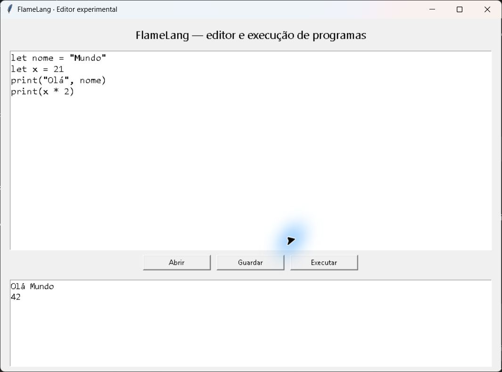

# FlameLang

<p align="center"></p>

FlameLang é uma linguagem experimental com um editor gráfico para trabalhar com variáveis,
expressões, condições, ciclos, funções e CSV. O editor permite abrir, guardar e executar ficheiros `.flame`.
Não é um simulador de incêndios nem a aplicação IgnisPyro Meteo.

## Instalação para utilizadores

O instalador candidato Windows x64 está em validação; **ainda não existe uma Release publicada**.
Quando aprovada, estará em [Releases](https://github.com/dsantananet/flame-lang/releases).
Descarregue o ficheiro `FlameLang-…-windows-x64-setup.exe`, execute o assistente e abra FlameLang no menu Iniciar.
Python, Git e Node.js não são necessários no computador do utilizador.
Desinstale em Definições → Aplicações → FlameLang. O ZIP de código-fonte não é um instalador.

## Utilização

```flame
let nome = "Mundo"
let x = 21
print("Olá", nome)
print(x * 2)
```

Abra o editor e clique em Executar. Use Abrir/Guardar para trabalhar com ficheiros.

## Requisitos e estado

Pacote candidato para Windows 10/11 x64; validação de instalação em máquina limpa pendente.
Linux e macOS não foram testados e não têm pacotes suportados.


## Limitações conhecidas

Estão implementados `let`, `print`, números, texto, listas, operações +, -, *, / e %,
comparações, `if/elif/else`, `for i in 1..5`, `def/return`, `load_csv`, `get`, `len`,
`to_number`, `.split` e `normalized_difference`. A indentação define os blocos.
Os exemplos de FWI apenas leem valores de exemplo e aplicam limiares didáticos: não calculam FWI
nem fornecem perigo oficial. Os PDFs antigos podem descrever objetivos futuros.
Os CSV devem estar na pasta do programa ou numa subpasta. O interpretador limita ciclos,
recursão, volume de dados e saída para evitar bloqueios do editor.
O interpretador deixou de executar Python arbitrário via eval/exec.

## Para programadores

Python 3.12+ com Tk. Execute `python desktop.py` ou `python flame_interpreter.py examples/hello.flame`.
Testes: `python -m unittest discover -s tests -p test_flame.py`.
Windows: instale `requirements-build.txt`, execute `python packaging/build.py` e compile
`packaging/windows.iss` com Inno Setup 6.7.3. O processo inclui Python e Tk no pacote.

## Novidades do candidato 0.2.0-rc.1

Editor gráfico, condições, ciclos, funções, CSV, exemplos executáveis, erros com número de linha,
interpretador restrito e instalação por utilizador.
Esta identificação não representa uma versão estável publicada.

## Licença e contacto

Licença [MIT](LICENSE), conforme declaração original. Consulte [avisos](LEGAL-NOTICE.md).
Contacto: [dsantananet](https://github.com/dsantananet); problemas em Issues deste repositório.
